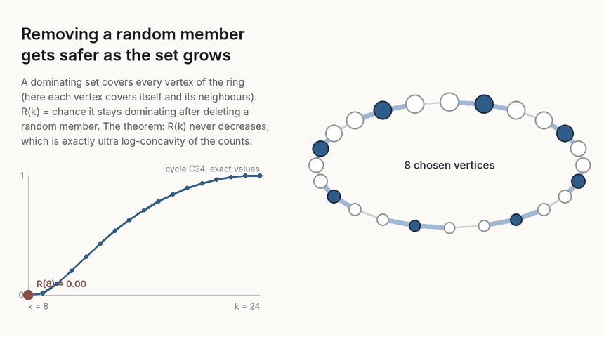

# Ultra log-concavity of the domination polynomials of powers of paths and cycles

**Answer: yes.** For all n ≥ 0 and ℓ ≥ 1, the number of dominating k-sets of the ℓ-th power of a path or a cycle, divided by C(n,k), is log-concave in k. This is an independent, self-contained proof of the conjecture of Galvin and Zhang. Galvin and Zhang report that Zheng and Qin earlier proposed a resolution by a different approach (personal communication). Their work is not public.

[Paper (PDF)](paper/manuscript.pdf) ·
[TeX source](paper/manuscript.tex) ·
[Problem and proof](proof/PROBLEM_AND_PROOF.md) ·
[Mathematical audit](audits/public_safe_reports/MATHEMATICAL_AUDIT.md) ·
[Literature and priority audit](audits/public_safe_reports/LITERATURE_PRIORITY_AUDIT_2026-11-26.md) ·
[Scope and limitations](CLAIM_SCOPE_AND_LIMITATIONS.md) ·
[Reproduce](REPRODUCIBILITY.md) ·
[3D explorer](visualization/README.md) ·
[Citation](CITATION.cff)

## The problem

A set of vertices is *dominating* if every vertex is in it or adjacent to it; γ_k(H) counts the dominating sets of size k. In the ℓ-th power G^ℓ, two vertices are adjacent when their distance in G is at most ℓ. Alikhani and Peng conjectured that domination sequences are unimodal. Beaton and Brown proved this for paths and cycles, and Galvin and Zhang extended it to all of their powers.

Galvin and Zhang ([Discrete Math. 350(3) (2027) 115520](https://doi.org/10.1016/j.disc.2026.115520), Conjecture 1.7; [arXiv:2408.12731](https://arxiv.org/abs/2408.12731), Conjecture 1.8) conjectured more. Let q_k = γ_k / C(n,k), the chance that a random k-set dominates. They conjectured that q_k is log-concave in k for every power of every path and cycle, and checked this for n, ℓ ≤ 500.

## The result

**Theorem.** For all n ≥ 0, ℓ ≥ 1 and G ∈ {P_n, C_n}, q_k² ≥ q_{k−1} q_{k+1} for 1 ≤ k ≤ n−1. In particular, these domination sequences are also log-concave.

- **Deletion probability.** q_{k−1}/q_k is the chance that a random dominating k-set survives deleting a random member, so the theorem says this chance never decreases as k grows.
- **Gaps.** A dominating set is a composition whose gaps are bounded by 2ℓ+1, with end gaps at most ℓ on a path. Deleting a member merges two gaps. A likelihood-ratio lemma for log-concave sequences shows that adding one more bounded gap to the rest makes the merged pair stochastically smaller, so it fits more often.
- **Paths.** An end deletion is compared with an interior deletion by a deficit-swap injection.
- **Priority.** This is not a first solution: a resolution by Zheng and Qin is reported in the published paper. As far as we know, this is the first publicly available proof.

## Explore the proof in 3D

The [interactive explorer](visualization/README.md) draws any power of a path or cycle as a ring you can rotate. Pick n and ℓ, sample a random dominating k-set, and delete a random member to see whether it survives. Next to the ring is the exact R(k) for that graph. It never decreases, which is the theorem.

Download [`visualization/domination-explorer.zip`](visualization/domination-explorer.zip), unzip it, and open the HTML file in a browser. It runs offline and uses no external libraries.

## Verification status

| Gate | Status |
|---|---|
| Proof | Complete and analytic; it does not rely on computation |
| Mathematical audit | Three independent AI audits (hostile, reconstruction, scope and computation): all pass, no invalid step found. Two auditors proved the result on their own before reading the proof |
| Computation | Corroborating only: exact checks for n ≤ 90, ℓ ≤ 11 (auditors: n ≤ 150, ℓ ≤ 30), intermediate claims, and a positive control |
| Literature and priority | Three search lanes through 2026-11-26. **Not first:** Zheng–Qin proposed a resolution earlier (unpublished). No published proof found |
| Formal verification | Not attempted |
| Peer review | Not peer reviewed |

## Citation

Not yet archived. See [`CITATION.cff`](CITATION.cff).

## Authorship and AI disclosure

The repository author identity is `DannyExperiments`. AI systems found the proof, audited it, wrote the verification code, ran the literature review and prepared the manuscript; no AI system is listed as an author. See [`AI_DISCLOSURE.md`](AI_DISCLOSURE.md) and [`PROVENANCE.md`](PROVENANCE.md).
